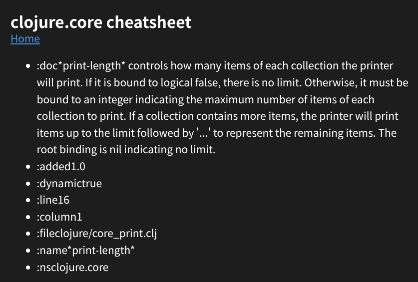
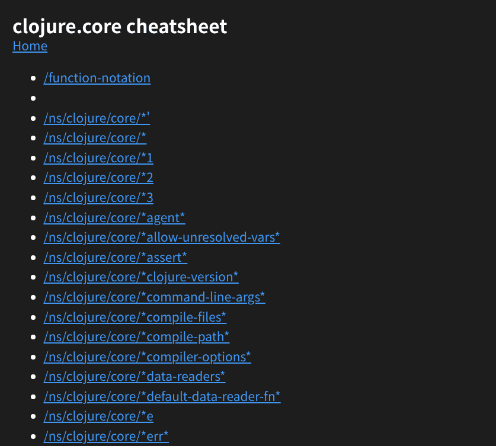

# visual-document

A static site generator for creating visual documentation and cheatsheets for Clojure core functions.

## Overview

This project generates a clean, browsable reference site for `clojure.core` functions. Built with Clojure and designed with Adobe Spectrum design tokens, it produces static HTML that can be deployed anywhere.

## Features

- Static site generation using Stasis
- HTML templating with Hiccup
- Built-in development server with hot reload
- Adobe Spectrum design system for consistent styling
- Cloudflare Pages deployment ready

## Requirements

- Clojure 1.12+
- Nix (optional, for reproducible builds)

## Getting Started

### Development Server

Start the local development server on port 8080:

```bash
make dev
```

Or run directly:

```bash
clojure -X visual-document.core/start-server
```

The screenshots below show the development server with the `clojure.core` data included in this repository.

The page for a var (`/ns/clojure/core/*print-length*/`):



The list of all pages (`/sitemap/`, top part):



### Build

Generate static files to the `target/` directory:

```bash
make build
```

### Run Tests

```bash
make test
```

### Deploy

Deploy to Cloudflare Pages:

```bash
make deploy
```

## Project Structure

```
src/visual_document/
  core.clj          # Main entry point, site configuration
  pages/            # Page generators
    index.clj       # Home page
    ns.clj          # Namespace documentation pages
    sitemap.clj     # Sitemap generator
resources/
  public/           # Static assets
  prd/              # Production data (YAML definitions)
```

## License

Apache License 2.0
